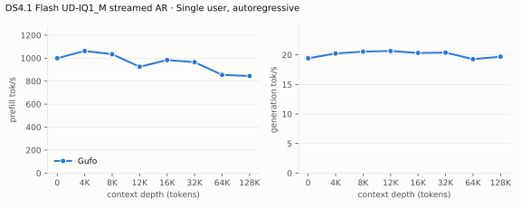
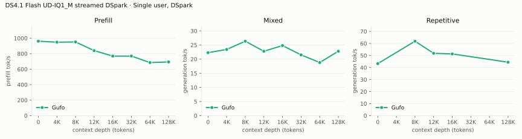
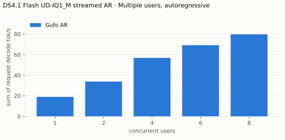
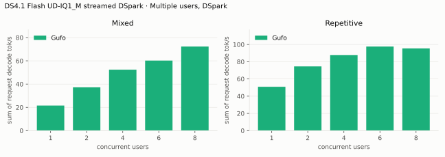
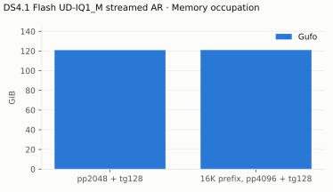

# DeepSeek V4.1 Flash benchmarks

AMD Strix Halo `gfx1151`, 128 GB unified memory. ISTA-DASLab GSQ-RCO
backbones: `IQ1_M` resident (first table of each section) and `IQ2_XXS` with
streamed routed experts (second table, after the rule); Unsloth `UD-IQ1_M`
with streamed routed experts (third table), sharing the ISTA Engram file;
`IQ4_NL` Engram tables read from disk, Lucebox Q2_K/Q4_K DSpark drafter. Gufo only: no other
engine runs DeepSeek V4.1 Flash on this machine, so the tables carry no
reference columns. HTTP through `gufo serve`, greedy, thinking off; measured
October 31, 2026 on the production `nix build` of `0eb9e89c`. Prefill rates
are the server's own prompt timings for real chat text; see
[native prefill](#native-prefill) for `gufo bench`.
[Method and quality](QUALITY.md) · [Experiments](EXPERIMENTS.md) ·
[Streaming design](STREAMING.md)

**Streamed `IQ2_XXS` and `UD-IQ1_M`.** The 128.75 GiB and 130 GiB models keep their dense weights
resident and reads routed experts from a Samsung 990 PRO (PCIe 4.0 NVMe)
into an expert cache that fills the free memory (`--stream-experts`,
defaults). Its speed depends on the disk: a slower SSD costs time on every
expert-cache miss, and misses are most frequent in a new server's first
requests. Each depth sweep and concurrency level starts a
new server, so these rows include that warm-up; a server that has served
similar text decodes faster.

## Single user, autoregressive

pp2048 / tg128; depth is the cached prefix in tokens.

<!-- bench:single-ar -->
| DS4.1 Flash IQ1_M AR Depth (tokens) | Gufo pp (tok/s) | Gufo tg (tok/s) |
| ---: | ---: | ---: |
| 0 | 1243.84 | 24.71 |
| 4,096 | 1237.13 | 24.49 |
| 8,192 | 1121.83 | 24.45 |
| 12,288 | 1217.04 | 24.31 |
| 16,384 | 1180.66 | 24.29 |
| 32,768 | 1194.97 | 24.22 |
| 65,536 | 1067.57 | 23.80 |
| 131,072 | 1055.97 | 23.31 |
<!-- /bench -->

---

<!-- bench:single-ar-iq2xxs -->
| DS4.1 Flash IQ2_XXS streamed AR Depth (tokens) | Gufo pp (tok/s) | Gufo tg (tok/s) |
| ---: | ---: | ---: |
| 0 | 1055.67 | 20.96 |
| 4,096 | 1057.61 | 22.24 |
| 8,192 | 1077.23 | 21.77 |
| 12,288 | 1096.16 | 22.60 |
| 16,384 | 1034.58 | 22.74 |
| 32,768 | 960.09 | 22.66 |
| 65,536 | 958.27 | 21.22 |
| 131,072 | 894.97 | 21.80 |
<!-- /bench -->

---

<!-- bench:single-ar-udiq1m -->
| DS4.1 Flash UD-IQ1_M streamed AR Depth (tokens) | Gufo pp (tok/s) | Gufo tg (tok/s) |
| ---: | ---: | ---: |
| 0 | 999.66 | 19.43 |
| 4,096 | 1062.53 | 20.24 |
| 8,192 | 1034.47 | 20.55 |
| 12,288 | 924.84 | 20.66 |
| 16,384 | 984.08 | 20.32 |
| 32,768 | 964.94 | 20.39 |
| 65,536 | 854.50 | 19.28 |
| 131,072 | 844.68 | 19.69 |
<!-- /bench -->

## Single user, DSpark

pp is the highest measured rate per depth across mixed/repetitive text. The
mixed workload asks for a summary and a story (a story at 64K); the
repetitive one copies a passage, which prompt lookup verifies up to 15 tokens
at a time. Greedy output is identical to plain decoding.

<!-- bench:single-dspark -->
| DS4.1 Flash IQ1_M DSpark Depth (tokens) | Gufo pp (tok/s) | Gufo tg mixed (tok/s) | Gufo tg repetitive (tok/s) |
| ---: | ---: | ---: | ---: |
| 0 | 1256.21 | 31.06 | 74.27 |
| 4,096 | 1102.66 | 30.92 | 72.50 |
| 8,192 | 1199.46 | 31.30 | 73.40 |
| 12,288 | 1123.05 | 30.97 | 74.32 |
| 16,384 | 1167.47 | 32.74 | 73.10 |
| 32,768 | 979.26 | 29.09 | 66.16 |
| 65,536 | 881.96 | 26.88 | 62.50 |
| 131,072 | 891.80 | 27.86 | 62.69 |
<!-- /bench -->

---

<!-- bench:single-dspark-iq2xxs -->
| DS4.1 Flash IQ2_XXS streamed DSpark Depth (tokens) | Gufo pp (tok/s) | Gufo tg mixed (tok/s) | Gufo tg repetitive (tok/s) |
| ---: | ---: | ---: | ---: |
| 0 | 959.40 | 23.91 | 54.78 |
| 4,096 | 1066.77 | 28.86 | 61.56 |
| 8,192 | 1024.08 | 26.29 | 56.45 |
| 12,288 | 879.91 | 23.75 | 54.05 |
| 16,384 | 795.49 | 26.87 | 50.39 |
| 32,768 | 830.62 | 29.32 | 55.09 |
| 65,536 | 739.29 | 21.20 | 49.01 |
| 131,072 | 721.78 | 22.75 | 47.16 |
<!-- /bench -->

---

<!-- bench:single-dspark-udiq1m -->
| DS4.1 Flash UD-IQ1_M streamed DSpark Depth (tokens) | Gufo pp (tok/s) | Gufo tg mixed (tok/s) | Gufo tg repetitive (tok/s) |
| ---: | ---: | ---: | ---: |
| 0 | 961.12 | 22.29 | 43.24 |
| 4,096 | 948.66 | 23.42 | stops¹ |
| 8,192 | 951.43 | 26.34 | 61.87 |
| 12,288 | 839.54 | 22.79 | 51.82 |
| 16,384 | 768.98 | 24.80 | 51.31 |
| 32,768 | 769.33 | 21.50 | stops¹ |
| 65,536 | 685.25 | 18.79 | stops¹ |
| 131,072 | 693.47 | 22.79 | 44.41 |
<!-- /bench -->

¹ At these depths greedy `UD-IQ1_M` answers the copy request with a one-line
comment on the passage and ends after 8–9 tokens, so there is no tg128 to
time. The reply is the same without DSpark and without the prompt cache.

## Multiple users, autoregressive

Same pp2048 prose prompt as single-user d0, tg128, context 4096 per user.
Every session is prepared from a C1 prompt checkpoint before timed decoding;
throughput sums individual request decode rates. Concurrent sessions decode
in one forward; every output matches its isolated C1 reference.

<!-- bench:multi-ar -->
| DS4.1 Flash IQ1_M AR Users | Gufo AR (tok/s) |
| ---: | ---: |
| 1 | 24.70 |
| 2 | 41.97 |
| 4 | 65.35 |
| 6 | 77.76 |
| 8 | 85.85 |
<!-- /bench -->

---

<!-- bench:multi-ar-iq2xxs -->
| DS4.1 Flash IQ2_XXS streamed AR Users | Gufo AR (tok/s) |
| ---: | ---: |
| 1 | 20.53 |
| 2 | 36.54 |
| 4 | 59.33 |
| 6 | 71.20 |
| 8 | 81.90 |
<!-- /bench -->

---

<!-- bench:multi-ar-udiq1m -->
| DS4.1 Flash UD-IQ1_M streamed AR Users | Gufo AR (tok/s) |
| ---: | ---: |
| 1 | 19.05 |
| 2 | 33.89 |
| 4 | 56.85 |
| 6 | 69.20 |
| 8 | 79.73 |
<!-- /bench -->

## Multiple users, DSpark

Same pp2048 mixed/repetitive prompts as single-user d0, tg128, context 4096
per user. Concurrent sessions verify their blocks jointly in batches of up to
16 rows; every output matches its isolated AR reference.

<!-- bench:multi-dspark -->
| DS4.1 Flash IQ1_M DSpark Users | Gufo mixed (tok/s) | Gufo repetitive (tok/s) |
| ---: | ---: | ---: |
| 1 | 31.41 | 75.43 |
| 2 | 45.87 | 88.65 |
| 4 | 60.44 | 94.07 |
| 6 | 66.50 | 107.06 |
| 8 | 74.88 | 99.25 |
<!-- /bench -->

---

<!-- bench:multi-dspark-iq2xxs -->
| DS4.1 Flash IQ2_XXS streamed DSpark Users | Gufo mixed (tok/s) | Gufo repetitive (tok/s) |
| ---: | ---: | ---: |
| 1 | 23.92 | 53.42 |
| 2 | 37.98 | 76.89 |
| 4 | 52.58 | 88.89 |
| 6 | 61.17 | 99.46 |
| 8 | 71.11 | 95.71 |
<!-- /bench -->

---

<!-- bench:multi-dspark-udiq1m -->
| DS4.1 Flash UD-IQ1_M streamed DSpark Users | Gufo mixed (tok/s) | Gufo repetitive (tok/s) |
| ---: | ---: | ---: |
| 1 | 21.57 | 50.91 |
| 2 | 37.20 | 74.56 |
| 4 | 52.40 | 87.62 |
| 6 | 60.22 | 97.60 |
| 8 | 72.26 | 95.46 |
<!-- /bench -->

## Prompt lookup

Repeating a 3,000-character C++ file with one function renamed (greedy, 900
tokens, think off): 67.6 tok/s with 16-row verification against 58.5 with the
previous 7-row limit; 62 verifications instead of 131, every copy accepted,
identical output ([E15](EXPERIMENTS.md)). Without a drafter, lookup alone
verifies copies the same way.

## Native prefill

`gufo bench` (synthetic token IDs, one 2048-row pass per pp2048) on the
October 29 `cd8b92c1` build: pp2048 1,394 ± 37 tok/s at depth 0 (three runs; 1,205 on the
October 26 build, [E16 record](artifacts/2026-10-26-prefill-batch/summary.txt)). Served chat prefill is lower for two measured
reasons: real text costs 5–7% more than the synthetic IDs in matched
batches, and the prompt cache's stable-boundary checkpoint adds a 3-token
pass (about 65 ms) to every chat request ([backlog](BACKLOG.md)). A profile
of served requests shows no other host idle time.

Prefill runs the decoder layers (20–39) over each prompt's last 140 tokens
only (decoder SWA bounded replay, [QUALITY.md](QUALITY.md));
`--exact-prefill` runs every decoder row at about half the prefill speed.
`--prefill-batch 4096` gains 2–3% natively but leaves the prompt cache no
memory in the default resident setup (E16), so 2048 stays the default.

## Vision encoder

`ds41_vision_probe` (gpu-test build, third of three encodes), ViT and aligner
of one image; the span then prefills like text.

| DS4.1 Flash vision Image | Patches | Tokens | Encode (ms) |
|---|---:|---:|---:|
| corn.jpeg | 1,551 | 189 | 83 |
| carrots.jpeg | 3,774 | 444 | 236 |
| 4000 × 3000 (token cap) | 8,748 | 1,001 | 746 |

`gufo serve`: carrots (456 prompt tokens) prefilled in 1.6 s including the
encode, then decoded at 23.6 tok/s; the capped image (1,011 prompt tokens)
answered in 4.1 s. The sidecar adds 0.90 GiB of device memory.

## Loading time

C1, capacity 262144, DSpark. Page cache dropped before the start, to HTTP
readiness; the weights upload from the files directly. Streamed `IQ2_XXS`
uploads its dense weights and preloads its built-in ranking of frequently
routed experts before it is ready.

<!-- bench:loading -->
| DS4.1 Flash Target | Gufo ready (s) |
| --- | ---: |
| IQ1_M | 19.69 |
| IQ2_XXS streamed | 22.46 |
| UD-IQ1_M streamed | 22.46 |
<!-- /bench -->

## Memory occupation

Capacity 262144 tokens, AR. Device total minus free, which on this unified
memory APU tracks system-wide use (3.01 GiB idle before the server starts);
it includes the prompt cache's retained checkpoints. Streamed `IQ2_XXS` and
`UD-IQ1_M` fill the memory left after their 4 GiB reserve with the expert
cache, so their rows show the cache's size, not a requirement.

<!-- bench:memory -->
| DS4.1 Flash IQ1_M AR Workload | Gufo GiB |
| --- | ---: |
| pp2048 + tg128 | 119.50 |
| 16K prefix, pp4096 + tg128 | 119.63 |
<!-- /bench -->

---

<!-- bench:memory-iq2xxs -->
| DS4.1 Flash IQ2_XXS streamed AR Workload | Gufo GiB |
| --- | ---: |
| pp2048 + tg128 | 120.86 |
| 16K prefix, pp4096 + tg128 | 120.98 |
<!-- /bench -->

---

<!-- bench:memory-udiq1m -->
| DS4.1 Flash UD-IQ1_M streamed AR Workload | Gufo GiB |
| --- | ---: |
| pp2048 + tg128 | 120.91 |
| 16K prefix, pp4096 + tg128 | 121.03 |
<!-- /bench -->

Resident components (`ds41_load_probe --upload` and `gufo serve`):

| DS4.1 Flash Component | GiB |
| --- | ---: |
| Weights (token embedding stays in the mapped file) | 112.27 |
| One session at the native 1M context | +2.3 (0.9 state, 1.4 batch scratch shared by all sessions) |
| Each further session at 1M | +0.9 |
| DSpark drafter, Q2_K/Q4_K | +4.59 |
| Vision sidecar | +0.90 |

With the drafter, one session at the native context and the server ready,
1.75 GiB of host memory remains available, and the prompt cache holds about
1.25 GB of checkpoints. A 27,559-token prompt captured in 9.5 ms (101 MB)
and restored in 2.9 ms with the same reply; short turns capture in
0.9–4.2 ms and restore in 0.8 ms.
