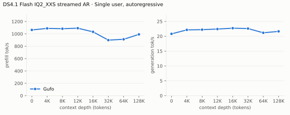
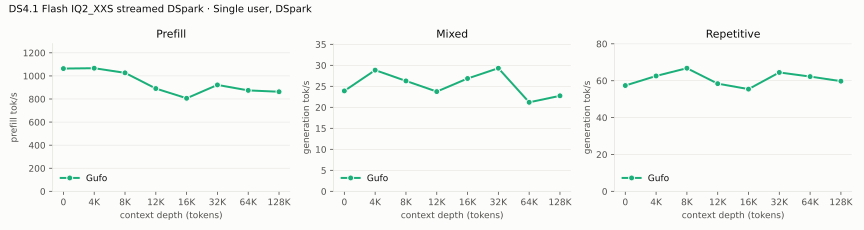
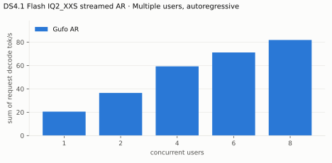
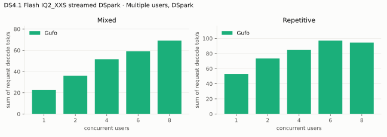
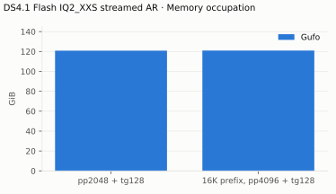

# DeepSeek V4.1 Flash benchmarks

AMD Strix Halo `gfx1151`, 128 GB unified memory. ISTA-DASLab GSQ-RCO
backbones: `IQ1_M` resident (first table of each section) and `IQ2_XXS` with
streamed routed experts (second table, after the rule); `IQ4_NL` Engram
tables read from disk, Lucebox Q2_K/Q4_K DSpark drafter. Gufo only: no other
engine runs DeepSeek V4.1 Flash on this machine, so the tables carry no
reference columns. HTTP through `gufo serve`, greedy, thinking off; measured
October 29, 2026 on the production `nix build` of `cd8b92c1`. Prefill rates
are the server's own prompt timings for real chat text; see
[native prefill](#native-prefill) for `gufo bench`.
[Method and quality](QUALITY.md) · [Experiments](EXPERIMENTS.md) ·
[Streaming design](STREAMING.md)

**Streamed `IQ2_XXS`.** The 128.75 GiB model keeps its dense weights
resident and reads routed experts from a Samsung 990 PRO (PCIe 4.0 NVMe)
into an expert cache that fills the free memory (`--stream-experts`,
defaults). Its speed depends on the disk: a slower SSD costs time on every
expert-cache miss, and misses are most frequent in a new server's first
requests. Each depth sweep and concurrency level starts a
new server, so these rows include that warm-up; a server that has served
similar text decodes faster.

## Single user, autoregressive

pp2048 / tg128; depth is the cached prefix in tokens.

<!-- bench:single-ar -->
| DS4.1 Flash IQ1_M AR Depth (tokens) | Gufo pp (tok/s) | Gufo tg (tok/s) |
| ---: | ---: | ---: |
| 0 | 1228.01 | 24.54 |
| 4,096 | 1214.32 | 24.43 |
| 8,192 | 1185.75 | 24.32 |
| 12,288 | 1195.52 | 24.25 |
| 16,384 | 1187.16 | 24.15 |
| 32,768 | 1176.89 | 24.05 |
| 65,536 | 1048.32 | 23.68 |
| 131,072 | 1044.74 | 23.14 |
<!-- /bench -->

---

<!-- bench:single-ar-iq2xxs -->
| DS4.1 Flash IQ2_XXS streamed AR Depth (tokens) | Gufo pp (tok/s) | Gufo tg (tok/s) |
| ---: | ---: | ---: |
| 0 | 1063.71 | 20.81 |
| 4,096 | 1088.58 | 22.15 |
| 8,192 | 1083.61 | 22.23 |
| 12,288 | 1091.82 | 22.43 |
| 16,384 | 1032.80 | 22.72 |
| 32,768 | 898.79 | 22.60 |
| 65,536 | 912.15 | 21.17 |
| 131,072 | 991.65 | 21.65 |
<!-- /bench -->

## Single user, DSpark

pp is the highest measured rate per depth across mixed/repetitive text. The
mixed workload asks for a summary and a story (a story at 64K); the
repetitive one copies a passage, which prompt lookup verifies up to 15 tokens
at a time. Greedy output is identical to plain decoding.

<!-- bench:single-dspark -->
| DS4.1 Flash IQ1_M DSpark Depth (tokens) | Gufo pp (tok/s) | Gufo tg mixed (tok/s) | Gufo tg repetitive (tok/s) |
| ---: | ---: | ---: | ---: |
| 0 | 1221.84 | 30.66 | 73.62 |
| 4,096 | 1177.91 | 32.47 | 70.95 |
| 8,192 | 1170.21 | 31.85 | 72.27 |
| 12,288 | 1169.49 | 30.39 | 70.41 |
| 16,384 | 1114.13 | 30.07 | 66.62 |
| 32,768 | 1055.01 | 29.80 | 66.63 |
| 65,536 | 1042.21 | 26.76 | 64.51 |
| 131,072 | 1030.02 | 29.88 | 64.35 |
<!-- /bench -->

---

<!-- bench:single-dspark-iq2xxs -->
| DS4.1 Flash IQ2_XXS streamed DSpark Depth (tokens) | Gufo pp (tok/s) | Gufo tg mixed (tok/s) | Gufo tg repetitive (tok/s) |
| ---: | ---: | ---: | ---: |
| 0 | 990.59 | 23.25 | 54.86 |
| 4,096 | 1066.41 | 24.17 | 61.87 |
| 8,192 | 1048.14 | 27.74 | 64.41 |
| 12,288 | 958.21 | 26.56 | 62.47 |
| 16,384 | 946.82 | 28.79 | 54.14 |
| 32,768 | 998.75 | 27.67 | 63.70 |
| 65,536 | 907.80 | 22.07 | 58.65 |
| 131,072 | 974.73 | 24.90 | 59.59 |
<!-- /bench -->

## Multiple users, autoregressive

Same pp2048 prose prompt as single-user d0, tg128, context 4096 per user.
Every session is prepared from a C1 prompt checkpoint before timed decoding;
throughput sums individual request decode rates. Concurrent sessions decode
in one forward; every output matches its isolated C1 reference.

<!-- bench:multi-ar -->
| DS4.1 Flash IQ1_M AR Users | Gufo AR (tok/s) |
| ---: | ---: |
| 1 | 24.21 |
| 2 | 41.33 |
| 4 | 64.48 |
| 6 | 76.55 |
| 8 | 86.05 |
<!-- /bench -->

---

<!-- bench:multi-ar-iq2xxs -->
| DS4.1 Flash IQ2_XXS streamed AR Users | Gufo AR (tok/s) |
| ---: | ---: |
| 1 | 20.22 |
| 2 | 35.61 |
| 4 | 59.42 |
| 6 | 72.05 |
| 8 | 81.52 |
<!-- /bench -->

## Multiple users, DSpark

Same pp2048 mixed/repetitive prompts as single-user d0, tg128, context 4096
per user. Concurrent sessions verify their blocks jointly in batches of up to
16 rows; every output matches its isolated AR reference.

<!-- bench:multi-dspark -->
| DS4.1 Flash IQ1_M DSpark Users | Gufo mixed (tok/s) | Gufo repetitive (tok/s) |
| ---: | ---: | ---: |
| 1 | 31.03 | 73.57 |
| 2 | 45.00 | 86.97 |
| 4 | 58.30 | 92.64 |
| 6 | 64.94 | 106.55 |
| 8 | 73.77 | 97.32 |
<!-- /bench -->

---

<!-- bench:multi-dspark-iq2xxs -->
| DS4.1 Flash IQ2_XXS streamed DSpark Users | Gufo mixed (tok/s) | Gufo repetitive (tok/s) |
| ---: | ---: | ---: |
| 1 | 22.70 | 53.00 |
| 2 | 36.09 | 73.41 |
| 4 | 51.63 | 84.76 |
| 6 | 59.04 | 97.04 |
| 8 | 69.13 | 94.42 |
<!-- /bench -->

## Prompt lookup

Repeating a 3,000-character C++ file with one function renamed (greedy, 900
tokens, think off): 67.6 tok/s with 16-row verification against 58.5 with the
previous 7-row limit; 62 verifications instead of 131, every copy accepted,
identical output ([E15](EXPERIMENTS.md)). Without a drafter, lookup alone
verifies copies the same way.

## Native prefill

`gufo bench` (synthetic token IDs, one 2048-row pass per pp2048) on the same
binary: pp2048 1,205 tok/s at depth 0 and 1,189 at 8K
([E16 record](artifacts/2026-10-26-prefill-batch/summary.txt): 1,149–1,187
at d0, 1,122–1,134 at 32K). Served chat prefill is lower for two measured
reasons: real text costs 5–7% more than the synthetic IDs in matched
batches, and the prompt cache's stable-boundary checkpoint adds a 3-token
pass (about 65 ms) to every chat request ([backlog](BACKLOG.md)). A profile
of served requests shows no other host idle time.

Prefill runs the decoder layers (20–39) over each prompt's last 140 tokens
only (decoder SWA bounded replay, [QUALITY.md](QUALITY.md));
`--exact-prefill` runs every decoder row at about half the prefill speed.
`--prefill-batch 4096` gains 2–3% natively but leaves the prompt cache no
memory in the default resident setup (E16), so 2048 stays the default.

## Vision encoder

`ds41_vision_probe` (gpu-test build, third of three encodes), ViT and aligner
of one image; the span then prefills like text.

| DS4.1 Flash vision Image | Patches | Tokens | Encode (ms) |
|---|---:|---:|---:|
| corn.jpeg | 1,551 | 189 | 83 |
| carrots.jpeg | 3,774 | 444 | 236 |
| 4000 × 3000 (token cap) | 8,748 | 1,001 | 746 |

`gufo serve`: carrots (456 prompt tokens) prefilled in 1.6 s including the
encode, then decoded at 23.6 tok/s; the capped image (1,011 prompt tokens)
answered in 4.1 s. The sidecar adds 0.90 GiB of device memory.

## Loading time

C1, capacity 262144, DSpark. Page cache dropped before the start, to HTTP
readiness; the weights upload from the files directly. Streamed `IQ2_XXS`
uploads its dense weights and preloads its built-in ranking of frequently
routed experts before it is ready.

<!-- bench:loading -->
| DS4.1 Flash Target | Gufo ready (s) |
| --- | ---: |
| IQ1_M | 19.67 |
| IQ2_XXS streamed | 22.51 |
<!-- /bench -->

## Memory occupation

Capacity 262144 tokens, AR. Device total minus free, which on this unified
memory APU tracks system-wide use (3.01 GiB idle before the server starts);
it includes the prompt cache's retained checkpoints. Streamed `IQ2_XXS`
fills the memory left after its 4 GiB reserve with its expert cache, so its
row shows the cache's size, not a requirement.

<!-- bench:memory -->
| DS4.1 Flash IQ1_M AR Workload | Gufo GiB |
| --- | ---: |
| pp2048 + tg128 | 119.57 |
| 16K prefix, pp4096 + tg128 | 119.72 |
<!-- /bench -->

---

<!-- bench:memory-iq2xxs -->
| DS4.1 Flash IQ2_XXS streamed AR Workload | Gufo GiB |
| --- | ---: |
| pp2048 + tg128 | 120.87 |
| 16K prefix, pp4096 + tg128 | 121.00 |
<!-- /bench -->

Resident components (`ds41_load_probe --upload` and `gufo serve`):

| DS4.1 Flash Component | GiB |
| --- | ---: |
| Weights (token embedding stays in the mapped file) | 112.27 |
| One session at the native 1M context | +2.3 (0.9 state, 1.4 batch scratch shared by all sessions) |
| Each further session at 1M | +0.9 |
| DSpark drafter, Q2_K/Q4_K | +4.59 |
| Vision sidecar | +0.90 |

With the drafter, one session at the native context and the server ready,
1.75 GiB of host memory remains available, and the prompt cache holds about
1.25 GB of checkpoints. A 27,559-token prompt captured in 9.5 ms (101 MB)
and restored in 2.9 ms with the same reply; short turns capture in
0.9–4.2 ms and restore in 0.8 ms.
