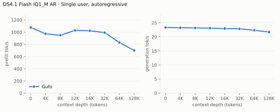
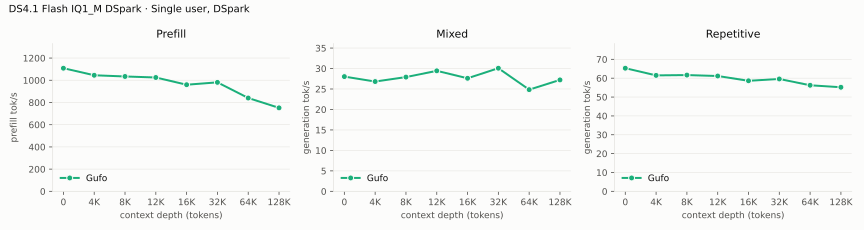
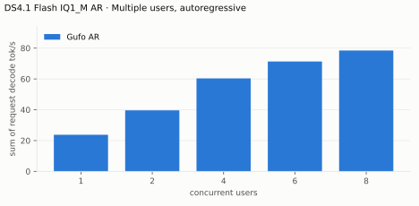
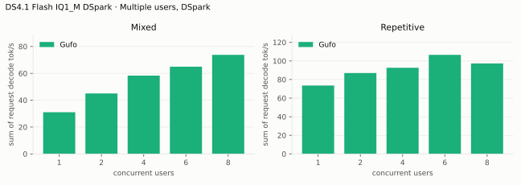
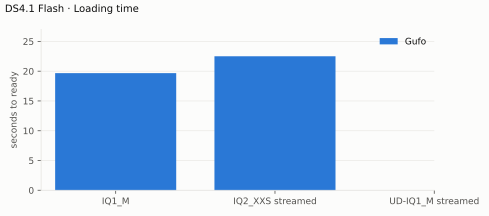
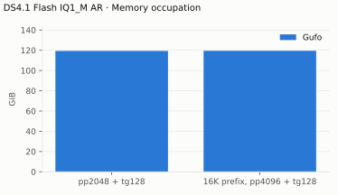

# DeepSeek V4.1 Flash benchmarks

AMD Strix Halo `gfx1151`, 128 GB unified memory. ISTA-DASLab GSQ-RCO `IQ1_M`
backbone resident (112.43 GiB), `IQ4_NL` Engram tables read from disk, Lucebox
Q2_K/Q4_K DSpark drafter. Gufo only: no other engine runs DeepSeek V4.1 Flash
on this machine, so the tables carry no reference columns. HTTP through
`gufo serve`, greedy, thinking off; measured October 26, 2026 on the production
`nix build` of `73bdd03b`. Prefill rates are the server's own prompt timings
for real chat text; see [native prefill](#native-prefill) for `gufo bench`.
[Method and quality](QUALITY.md) · [Experiments](EXPERIMENTS.md)

## Streamed IQ2_XXS, preliminary native measurements

On the same 128 GB Strix Halo with a Samsung 990 PRO, the 128.75 GiB
`IQ2_XXS` backbone streams its routed experts and keeps the dense weights
resident. These are native `gufo bench` pp2048/tg128 measurements with
synthetic tokens and no drafter, not the HTTP prose workload in the tables
below. Each process starts with empty expert slots; before each run only the
model and Engram files' clean page-cache entries are evicted. The tg test
follows the prefill test in the same process, so its expert cache is partly
warm. Each range contains the two retained matched runs.

| Reader and kernels | Prefill tok/s | Decode tok/s |
| --- | ---: | ---: |
| One buffered reader | 144.5–144.8 | 5.77–6.01 |
| Four buffered readers | 172.6–172.9 | 6.80–7.16 |
| Four direct readers | 213.8–214.1 | 8.97–8.98 |
| Direct reads, IQ2_XS FP16 kernel and shared-expert overlap | 219.6–219.8 | 9.02 |

For a repeated identical prompt and generation in the same process, the
second prefill reached 937 tok/s and the second decode 13.44 tok/s with both
buffered and direct reads. Real sessions, cache history and speculative
acceptance can give different rates. The raw comparisons, filesystem controls
and other engines' configurations are in [streaming research](STREAMING.md).

With the built-in ranking preloading 10,240 experts at startup and the
overlapped staging of October 27 (per-expert weight tables, split hit/miss
launches, per-reader upload streams), the same pp2048/tg128 measurements with
the histogram sidecar reach 666.1–669.6 tok/s prefill and 14.99–15.00 tok/s
decode without a drafter, and 17.92–17.94 tok/s with the Lucebox DSpark
drafter (same 110 drafted / 71 accepted and the same token hash as the
previous build; the DSpark prefill runs spread 494–628 tok/s with the page
cache, so the AR prefill pair is the retained number). At the native
1M-context budget the streamed model peaks at 106.4 GiB RSS with 8.7 GiB
still available.

## Single user, autoregressive

pp2048 / tg128; depth is the cached prefix in tokens.

<!-- bench:single-ar -->
| DS4.1 Flash IQ1_M AR Depth (tokens) | Gufo pp (tok/s) | Gufo tg (tok/s) |
| ---: | ---: | ---: |
| 0 | 1076.84 | 23.33 |
| 4,096 | 973.70 | 23.24 |
| 8,192 | 948.54 | 23.16 |
| 12,288 | 1030.20 | 23.09 |
| 16,384 | 1022.83 | 22.93 |
| 32,768 | 992.66 | 22.85 |
| 65,536 | 830.18 | 22.34 |
| 131,072 | 699.62 | 21.69 |
<!-- /bench -->

## Single user, DSpark

pp is the highest measured rate per depth across mixed/repetitive text. The
mixed workload asks for a summary and a story (a story at 64K); the
repetitive one copies a passage, which prompt lookup verifies up to 15 tokens
at a time. Greedy output is identical to plain decoding.

<!-- bench:single-dspark -->
| DS4.1 Flash IQ1_M DSpark Depth (tokens) | Gufo pp (tok/s) | Gufo tg mixed (tok/s) | Gufo tg repetitive (tok/s) |
| ---: | ---: | ---: | ---: |
| 0 | 1108.62 | 28.03 | 65.29 |
| 4,096 | 1045.03 | 26.82 | 61.48 |
| 8,192 | 1034.19 | 27.91 | 61.65 |
| 12,288 | 1025.00 | 29.44 | 61.15 |
| 16,384 | 959.91 | 27.62 | 58.61 |
| 32,768 | 981.24 | 30.08 | 59.58 |
| 65,536 | 840.16 | 24.84 | 56.24 |
| 131,072 | 751.62 | 27.22 | 55.19 |
<!-- /bench -->

## Multiple users, autoregressive

Same pp2048 prose prompt as single-user d0, tg128, context 4096 per user.
Every session is prepared from a C1 prompt checkpoint before timed decoding;
throughput sums individual request decode rates. Concurrent sessions decode
in one forward; every output matches its isolated C1 reference.

<!-- bench:multi-ar -->
| DS4.1 Flash IQ1_M AR Users | Gufo AR (tok/s) |
| ---: | ---: |
| 1 | 23.78 |
| 2 | 39.61 |
| 4 | 60.35 |
| 6 | 71.33 |
| 8 | 78.46 |
<!-- /bench -->

## Multiple users, DSpark

Same pp2048 mixed/repetitive prompts as single-user d0, tg128, context 4096
per user. Concurrent sessions verify their blocks jointly in batches of up to
16 rows; every output matches its isolated AR reference. Each session still
drafts full blocks at any concurrency, so from four users a step needs
several joint evaluations and mixed text decodes slower than AR; fitting the
drafts into one 16-row pass is open work
([backlog](BACKLOG.md)).

<!-- bench:multi-dspark -->
| DS4.1 Flash IQ1_M DSpark Users | Gufo mixed (tok/s) | Gufo repetitive (tok/s) |
| ---: | ---: | ---: |
| 1 | 27.63 | 65.40 |
| 2 | 40.49 | 69.41 |
| 4 | 51.22 | 71.82 |
| 6 | 52.42 | 71.53 |
| 8 | 55.93 | 71.21 |
<!-- /bench -->

## Prompt lookup

Repeating a 3,000-character C++ file with one function renamed (greedy, 900
tokens, think off): 67.6 tok/s with 16-row verification against 58.5 with the
previous 7-row limit; 62 verifications instead of 131, every copy accepted,
identical output ([E15](EXPERIMENTS.md)). Without a drafter, lookup alone
verifies copies the same way.

## Native prefill

`gufo bench` (synthetic token IDs, one 2048-row pass per pp2048) on the same
binary: pp2048 1,205 tok/s at depth 0 and 1,189 at 8K
([E16 record](artifacts/2026-10-26-prefill-batch/summary.txt): 1,149–1,187
at d0, 1,122–1,134 at 32K). Served chat prefill is lower for two measured
reasons: real text costs 5–7% more than the synthetic IDs in matched
batches, and the prompt cache's stable-boundary checkpoint adds a 3-token
pass (about 65 ms) to every chat request ([backlog](BACKLOG.md)). A profile
of served requests shows no other host idle time.

Prefill runs the decoder layers (20–39) over each prompt's last 140 tokens
only (decoder SWA bounded replay, [QUALITY.md](QUALITY.md));
`--exact-prefill` runs every decoder row at about half the prefill speed.
`--prefill-batch 4096` gains 2–3% natively but leaves the prompt cache no
memory in the default resident setup (E16), so 2048 stays the default.

## Vision encoder

`ds41_vision_probe` (gpu-test build, third of three encodes), ViT and aligner
of one image; the span then prefills like text.

| DS4.1 Flash vision Image | Patches | Tokens | Encode (ms) |
|---|---:|---:|---:|
| corn.jpeg | 1,551 | 189 | 83 |
| carrots.jpeg | 3,774 | 444 | 236 |
| 4000 × 3000 (token cap) | 8,748 | 1,001 | 746 |

`gufo serve`: carrots (456 prompt tokens) prefilled in 1.6 s including the
encode, then decoded at 23.6 tok/s; the capped image (1,011 prompt tokens)
answered in 4.1 s. The sidecar adds 0.90 GiB of device memory.

## Loading time

C1, capacity 262144, DSpark. Page cache dropped before the start, to HTTP
readiness; the weights upload from the files directly.

<!-- bench:loading -->
| DS4.1 Flash IQ1_M Target | Gufo ready (s) |
| --- | ---: |
| IQ1_M | 18.63 |
<!-- /bench -->

## Memory occupation

Capacity 262144 tokens, AR. Device total minus free, which on this unified
memory APU tracks system-wide use (3.02 GiB idle before the server starts);
it includes the prompt cache's retained checkpoints.

<!-- bench:memory -->
| DS4.1 Flash IQ1_M AR Workload | Gufo GiB |
| --- | ---: |
| pp2048 + tg128 | 119.36 |
| 16K prefix, pp4096 + tg128 | 119.51 |
<!-- /bench -->

Resident components (`ds41_load_probe --upload` and `gufo serve`):

| DS4.1 Flash Component | GiB |
| --- | ---: |
| Weights (token embedding stays in the mapped file) | 112.27 |
| One session at the native 1M context | +2.3 (0.9 state, 1.4 batch scratch shared by all sessions) |
| Each further session at 1M | +0.9 |
| DSpark drafter, Q2_K/Q4_K | +4.59 |
| Vision sidecar | +0.90 |

With the drafter, one session at the native context and the server ready,
1.75 GiB of host memory remains available, and the prompt cache holds about
1.25 GB of checkpoints. A 27,559-token prompt captured in 9.5 ms (101 MB)
and restored in 2.9 ms with the same reply; short turns capture in
0.9–4.2 ms and restore in 0.8 ms.
